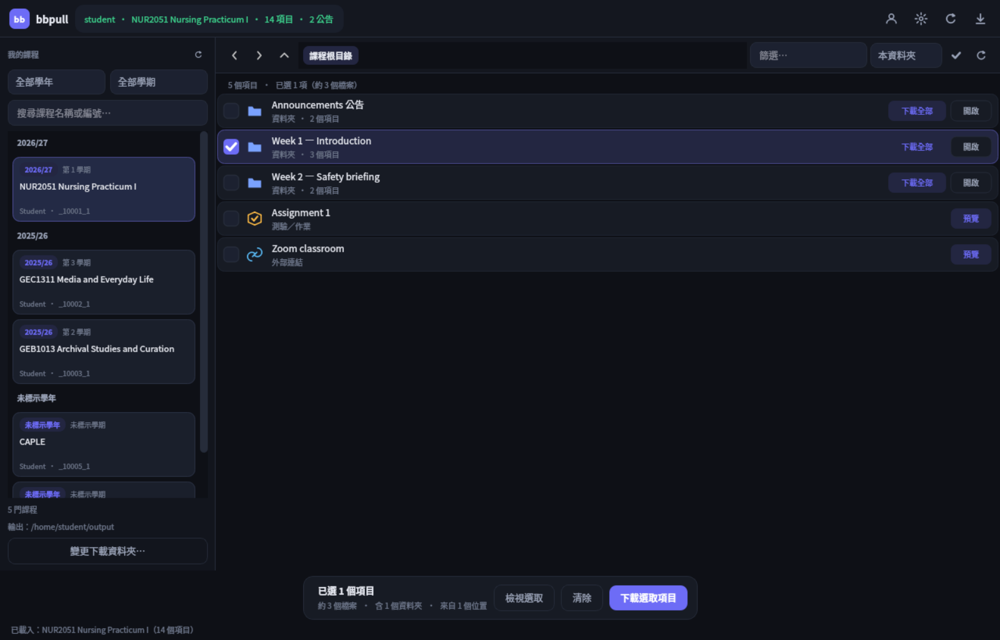
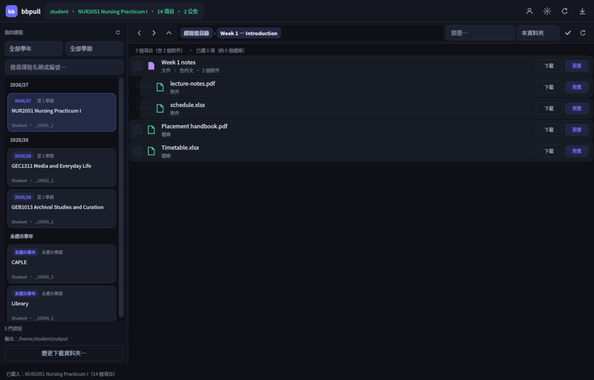
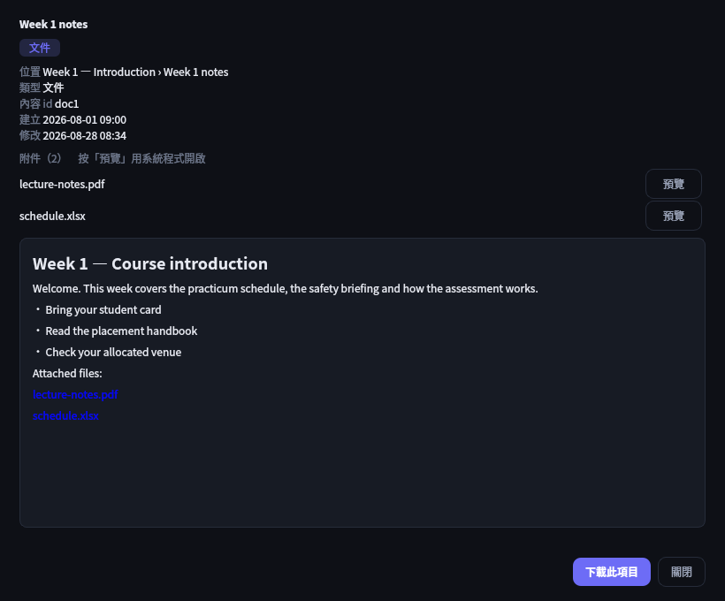

# bbpull

把 **Blackboard Learn (Ultra)** 課程的教材內容與公告抓到本機。

- 保留課程原本的資料夾結構
- 文件轉 Markdown，附件與內嵌圖片一起下載
- 桌面介面（像檔案總管一樣瀏覽、預覽、勾選下載）與命令列

只讀取 Blackboard，不會修改任何線上內容。



## 下載

到 [Releases](../../releases) 下載對應平台的壓縮檔。

| 平台 | 檔案 | 啟動 |
| --- | --- | --- |
| Windows x64 | `bbpull-*-windows-x64.zip` | 解壓後雙擊 `bbpull-gui.exe` |
| Linux x86_64 | `bbpull-*-linux-x86_64.tar.gz` | `./bbpull gui` |

Linux 也可 `./install.sh`：免 root 安裝到 `~/.local`，建立 `bbpull` 指令、選單與桌面捷徑
（`--uninstall` 移除；`--no-desktop` 不建捷徑）。`./bbpull shortcut` 可只重建捷徑。

第一次開啟會詢問站台／帳號／密碼。登入狀態存放於：

- **Windows**：`%LOCALAPPDATA%\bbpull`，密碼用 **DPAPI** 綁定 Windows 帳號
- **Linux**：`$XDG_DATA_HOME/bbpull`（預設 `~/.local/share/bbpull`），密碼用桌面鑰匙圈；
  沒有鑰匙圈時退回 0600 檔案，`bbpull doctor` 會照實說明

## 功能

- **預覽**：文件與公告內文（Markdown）、檔名／MIME、建立修改時間與所在路徑，不必先下載
- **內嵌附件**：文件裡的 PDF／Excel／DOCX 以懸掛式子列顯示，可單獨下載或用系統程式預覽
- **選擇性下載**：勾選資料夾＝整個子樹；可在不同資料夾累積選取，最後一次下載
- **指定下載資料夾**：左下「變更下載資料夾…」，寫入 `.env`，GUI 與 CLI 共用
- **CLI 與 GUI 共用**同一套設定、快取與輸出結構





## 從原始碼執行

需要 Python 3.9+（Windows 3.13、Linux 3.14 驗證）。

```bash
python3 -m bbpull venv --create   # 建立 .venv 並安裝相依套件
python3 -m bbpull gui             # 開啟桌面介面
```

Windows 把 `python3` 換成 `python`；Linux／macOS 也可用 `./bbpull.sh gui`。
`gui --check` 會說明使用哪個引擎（Qt 是預設，Tk 是選用降級介面）。

## 命令列

打包版是 `bbpull`；原始碼版是 `python -m bbpull` 或 `./bbpull.sh`。

```bash
bbpull pull --course-id _12529_1        # 抓一門課
bbpull pull-all                         # 抓全部已選課程
bbpull courses                          # 列出課程
bbpull list-content --course-id _12529_1  # 只印大綱，不下載
bbpull doctor                           # 設定與連線狀態
```

| 旗標 | 說明 |
| --- | --- |
| `--course-id` | 課程 id，例如 `_12529_1` |
| `--out` | 輸出目錄（預設 `output/`） |
| `--no-files` | 只寫文字與中介資料，不下載附件 |
| `--no-content` / `--no-announcements` | 只抓其中一種 |
| `--overwrite` | 重新下載已存在的檔案 |

輸出：

```
output/<課程>/
├── index.md              # 公告連結 + 完整大綱
├── _manifest.json        # 本次統計與失敗清單
├── content/              # 教材（文件 .md + .json、附件原檔）
└── announcements/        # 公告
```

Exit codes：`0` 成功、`2` 設定錯誤、`3` 登入失敗、`4` API 錯誤、`5` 部分檔案失敗。

其他子命令：`menu`、`setup`、`secure`、`login`、`selftest`、`venv`、`shortcut`。

## 無法登入

登入失敗時會轉述站台回覆的原文：

| 訊息 | 意思與處理 |
| --- | --- |
| `username or password ... incorrect` | 帳密不對、被鎖定或要改密碼；先用瀏覽器確認 |
| `MFA／TOTP` | 密碼正確但要驗證碼；無法自動化，改用 cookie |
| `站台把登入導向 …（SSO）` | 學校走 SSO；改用 cookie |

Cookie 匯入（`BB_COOKIE_FILE` 或 `--cookie-file`）接受三種格式：本程式 JSON jar、
瀏覽器擴充套件的 JSON 陣列、Netscape `cookies.txt`。

```bash
BB_COOKIE_FILE=~/cookies.txt bbpull doctor
```

> Windows 的 DPAPI 密碼無法帶到 Linux；Linux 第一次使用需要重新輸入一次密碼。

## 專案結構

```
bbpull/
├── bbpull/
│   ├── gui_qt/        # Qt 桌面介面（預設）：視窗、model/view、預覽
│   ├── gui/           # Tk 降級介面
│   ├── session.py     # 登入、cookie、下載
│   ├── course.py      # 課程大綱與附件
│   ├── catalog.py     # 瀏覽模型與快取
│   ├── preview.py     # 預覽與附件的純邏輯
│   ├── config.py      # 設定與憑證
│   └── shortcut.py    # 桌面捷徑（.desktop / .lnk）
├── tools/             # 建置腳本、機密掃描
├── tests/             # 單元測試
├── bbpull.spec        # PyInstaller 設定
└── bbpull.sh          # Linux／macOS 啟動檔
```

## 測試與打包

```bash
python -m bbpull selftest              # 681 項離線測試 + 機密掃描
python -m unittest tests.test_gui_qt   # 82 項 Qt 介面測試
python tools/build_exe.py              # 建置目前平台的執行檔
```

Windows 版由 GitHub Actions 的 `windows-latest` 建置，
見 [`.github/workflows/build-windows.yml`](.github/workflows/build-windows.yml)。

## 授權

[MIT](LICENSE)。抓下來的教材仍受著作權與校方規範約束，請勿散布。

更深入的內容（設計取捨、效能量測、打包流程、疑難排解）見
[`docs/DEVELOPMENT.md`](docs/DEVELOPMENT.md)。
